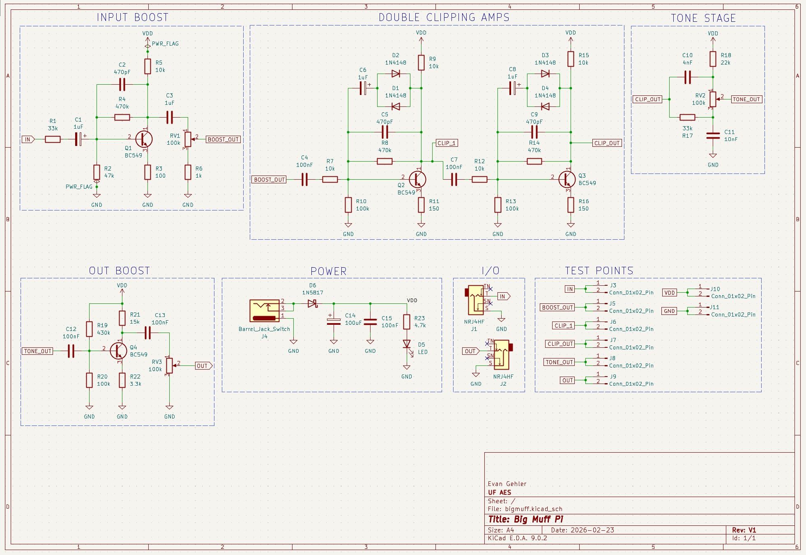
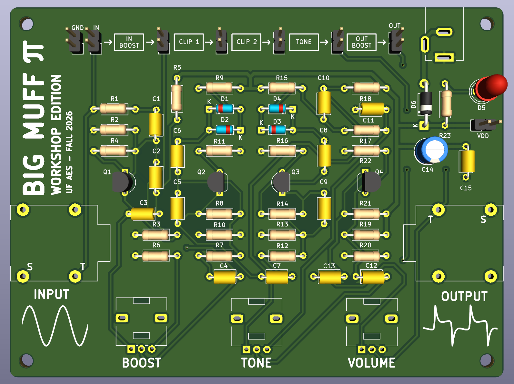
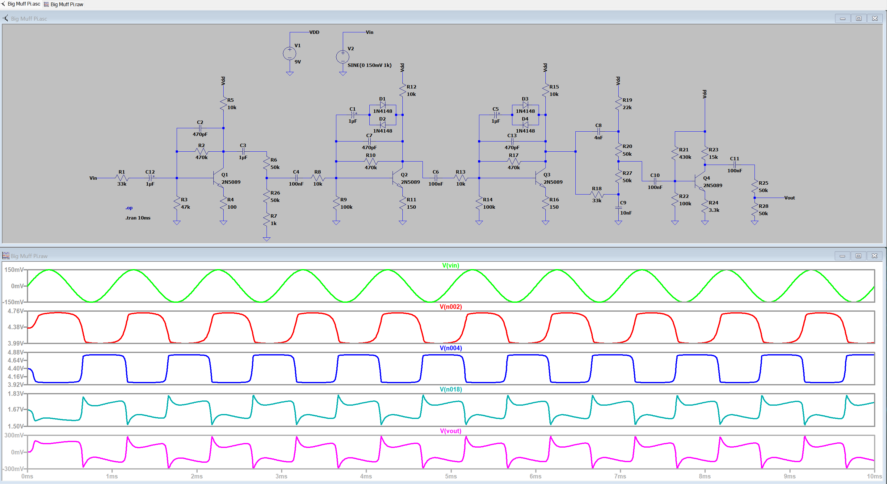

# Big Muff Pi Build

This project serves as an example guitar pedal build and some best practices for documentation / builds for UF AES Design

*(I also just really wanted a Big Muff)*

## Overview

List out how to go about this jawn

## Table of Contents
- [Hardware](#hardware)
    - [Schematic](#schematic)
    - [PCB](#pcb)
- [Simulation](#ltspice-simulation)
- [Bill of Materials](#bill-of-materials-bom)

## Project Status

| Phase                 | Status         | 
| -----                 | --------       | 
| LTSpice Simulation    | ✅             | 
| Schematic             | ✅             | 
| Component Footprints  | ✅             | 
| PCB                   | ✅              | 

## Hardware 
### Schematic:

### PCB:

## LTSpice Simulation

## Bill of Materials (BOM)

| PART                      | QTY | Part #                                 |
| ------------------------- | --- | -------------------------------------- |
| BC549 NPN Transistor      | 4   | Q1, Q2, Q3, Q4                         |
| 1N4148 Silicon Diode      | 4   | D1, D2, D3, D4                         |
| 1N5817 Schottky Diode     | 1   | D6                                     |
| 5mm LED                   | 1   | D5                                     |
| 100k Potentiometer        | 3   | RV1, RV2, RV3                          |
| 470k Resistor             | 3   | R4, R8, R14                            |
| 430k Resistor             | 1   | R19                                    |
| 100k Resistor             | 3   | R10, R13, R20                          |
| 47k Resistor              | 1   | R2                                     |
| 33k Resistor              | 2   | R1, R17                                |
| 22k Resistor              | 1   | R18                                    |
| 15k Resistor              | 1   | R21                                    |
| 10k Resistor              | 5   | R5, R7, R9, R12, R15                   |
| 4.7k Resistor             | 1   | R23                                    |
| 3.3k Resistor             | 1   | R22                                    |
| 1k Resistor               | 1   | R6                                     |
| 150 Resistor              | 2   | R11, R16                               |
| 100 Resistor              | 1   | R3                                     |
| 100uF Electrolytic Cap    | 1   | C14                                    |
| 1uF Capacitor             | 4   | C1, C3, C6, C8                         |
| 100nF Capacitor           | 5   | C4, C7, C12, C13, C15                  |
| 10nF Capacitor            | 1   | C11                                    |
| 4nF Capacitor             | 1   | C10                                    |
| 470pF Capacitor           | 3   | C2, C5, C9                             |
| Neutrik NRJ4HF 1/4" Jack  | 2   | J1, J2                                 |
| Barrel Jack w/ Switch     | 1   | J4                                     |
| 2-Pin Header (2.54mm)     | 8   | J3, J5, J6, J7, J8, J9, J10, J11       |
| M3 Mounting Hole          | 4   | H1, H2, H3, H4                         |
